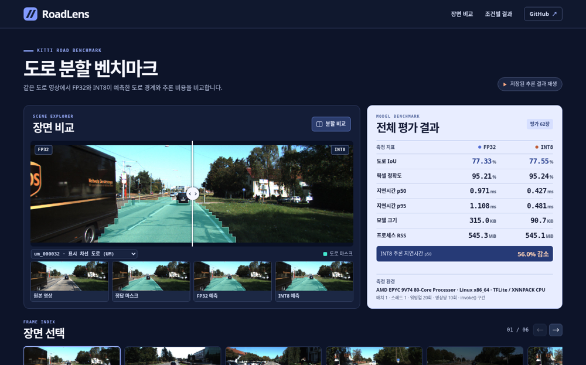

# RoadLens · 전방 카메라 도로 분할의 INT8 실행 분석

**[공개 데모](https://roadlens-kitti-int8.ykh13571.chatgpt.site) · [소스 다운로드](https://roadlens-kitti-int8.ykh13571.chatgpt.site/downloads/roadlens-source.zip) · [직무 요건별 근거표](docs/evidence.md) · [실험 원본](artifacts)**

실제 주행 이미지에서 도로를 분할하는 79,569개 파라미터의 CNN을 학습하고, 같은 가중치를 FP32·완전 정수 INT8 TFLite로 변환했다. 동일한 평가 62장에서 INT8은 모델 파일을 **71.2%** 줄이고 이 CPU의 순수 추론 지연시간 중앙값을 **56.0%** 줄였다. 원본 장면의 도로 IoU는 77.33%와 77.55%였다. 공개 데모는 **저장된 추론 결과를 재생**한다.



| 평가 및 실행 조건 | FP32 | INT8 |
|---|---:|---:|
| 도로 IoU · 이미지 평면 유효 픽셀 합산 | 77.331% | 77.547% |
| 픽셀 정확도 | 95.207% | 95.242% |
| CPU invoke p50 / p95 | 0.971 / 1.108 ms | 0.427 / 0.481 ms |
| 모델 파일 크기 | 322,536 B | 92,832 B |
| 워밍업 직후 전체 프로세스 RSS | 545.34 MiB | 545.11 MiB |
| 모델 로드 전 대비 RSS 증가 | 7.03 MiB | 5.41 MiB |

KITTI Road 라벨 289장을 **원본 주행 ID로 분리**했다. 학습 201장(26개 주행), 보정 26장(4개), 평가 62장(7개)이다. Linux x86-64, AMD EPYC 9V74, TensorFlow Lite 2.19.1, CPU/XNNPACK, 배치 1, 스레드 1. 모델마다 별도 프로세스에서 20회 워밍업한 뒤 같은 순서로 62장 × 10회 호출해 측정했다. CPU p50에는 디코딩·리사이즈·입출력 양자화를 제외했다. 모델 로드 시점 RSS는 모델 저장용량이나 보드 SRAM 사용량과 다르다. [원시 시간 CSV](artifacts/latency.csv) · [정확도·메모리 측정 기준](docs/evaluation.md)

## 어디에서 실패했나

원본 무표시 도로의 INT8 IoU는 70.89%였다. 중앙을 가린 합성 입력에서는 74.73%, RGB 밝기를 35%로 줄인 합성 저조도에서는 33.06%였다. 데모의 `um_000028_dim`에서는 두 모델 모두 정답 도로 2,252픽셀 전부를 놓쳤다. 이 데이터는 실제 야간이나 소형 객체 검출 결과를 제공하지 않는다. 검출 임계값은 0.5로 고정했다. [장면별 정답·예측 통계](artifacts/scene_metrics.csv) · [개별 조건과 장면 선택](docs/evaluation.md)

## NPU를 위해 확인한 범위

| 구간 | 검증 근거 |
|---|---|
| CPU 실제 추론 | Keras 복원 결과와 FP32 TFLite의 최대 확률 차이 0.00000370. FP32·INT8 TFLite 모두 CPU에서 실행 |
| Arm Ethos-U55-128용 컴파일 | 실제 Vela 4.4.1 출력에서 FP32는 CPU 연산 17개, INT8은 NPU 구간 1개·CPU 연산 0개 |
| 지원하지 않는 연산 | 별도 SIN 진단 그래프에서 NPU 2구간, CPU 3연산과 경계 2개를 검출 |
| 컴파일러 추정 | 500 MHz 예제 설정에서 INT8 628,069 cycles, SRAM 276 KiB. NPU 보드에서의 실행·시간·전력은 미측정 |

[CPU 실행기](src/runtime.py) · [컴파일 어댑터](src/compiler.py) · [원본 그래프와 컴파일러 결과](artifacts/vela) · [CPU/NPU 경계 해석](docs/runtime.md)

## 재현

Linux x86-64와 Python 3.12에서 실행한다. Pytest는 커밋된 두 모델과 컴파일 산출물을 읽으며 KITTI 다운로드 없이 실행할 수 있다.

```bash
git clone https://github.com/sokldjs554/roadlens-int8.git
cd roadlens-int8
python3.12 -m venv .venv
. .venv/bin/activate
python -m pip install -r requirements.lock
python -m pytest -q
```

동일한 평가 집합에서 추론을 다시 실행한다. 아래 명령은 기록된 원본을 보존하면서 새 결과를 `work/recheck`에 저장한다.

```bash
mkdir -p work/recheck/artifacts
curl -fL --retry 3 https://s3.eu-central-1.amazonaws.com/avg-kitti/data_road.zip -o work/data_road.zip
cp artifacts/{fp32.tflite,int8.tflite,split.json} work/recheck/artifacts/
python -m src.bench --archive work/data_road.zip --artifacts work/recheck/artifacts --web work/recheck/gallery
python -m src.compiler artifacts/int8.tflite work/recheck/vela-int8
python -m src.compiler artifacts/fp32.tflite work/recheck/vela-fp32
python -m src.fallback_probe work/recheck/probe
```

모델 학습부터 재현할 때는 공식 매핑 ZIP도 받는다. [학습·보정·변환 명령과 원본 해시](docs/training.md)

```bash
curl -fL --retry 3 https://s3.eu-central-1.amazonaws.com/avg-kitti/devkit_road_mapping.zip -o work/devkit_road_mapping.zip
python -m src.train --data work/data_road.zip --mapping work/devkit_road_mapping.zip --out work/retrain
```

## 데모 검증과 버전 대조

Git checkout에서 `python scripts/build_site.py`를 실행하면 `dist/`에 정적 데모, 근거 문서, Git 커밋의 소스 ZIP과 SHA-256 목록이 생긴다. `python -m http.server 8000 --directory dist`로 로컬에서 열 수 있다. 배포본의 `release.json`에서 테스트할 커밋을 확인한다. 아래 브라우저 검사는 시스템 Chromium과 별도로 설치한 Playwright 1.62.0을 사용한다.

```bash
python -m pip install playwright==1.62.0
python tests/browser_smoke.py https://roadlens-kitti-int8.ykh13571.chatgpt.site/
python scripts/verify_release.py https://roadlens-kitti-int8.ykh13571.chatgpt.site/
```

단위·회귀 검사 19개가 통과했다. 보정 입력 shape 오류로 실제 변환 실패를 유발한 후 기존 모델 보존과 재시도를 검사했다. CPU 런타임의 손상 FlatBuffer·잘못된 RGB·호출 오류 회복도 검사했다. [테스트 출력](artifacts/checks/pytest.txt) · [브라우저 검사 코드](tests/browser_smoke.py) · [모바일 레이아웃](artifacts/checks/mobile-preview.png) · [배포본 해시](https://roadlens-kitti-int8.ykh13571.chatgpt.site/release.json)

## 출처와 기여

사용자는 과제와 기준을 정하고 GitHub 저장소를 개설했다. Codex가 이번 프로젝트의 소스·실험·검증·데모를 제작했다. 기존 저장소 6곳은 커밋 고정 코드·테스트·결과·데모를 조사해 실험 방법을 참고했다. [공고와 역할 기록](docs/brief.md) · [선행 저장소 비교](docs/prior.md) · [국내외 디자인·모델군 조사](docs/references.md) · [KITTI 데이터 이용 조건](NOTICE.md)
