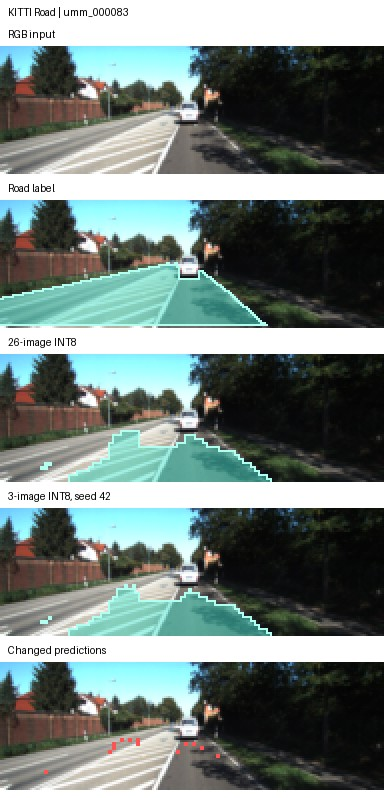

# KITTI Road INT8 보정 장수 비교

공개 가중치와 평가 영상 62장을 고정했을 때, 도로 유형별로 한 장씩 고른 **3장이 시험한 최소 통과 조건**이었다. 3장과 9장 모두 세 시드에서 26장 대비 전체 도로 IoU 하락을 0.5%p 이내로 제한했다. [실행 전 판정 기준](../../docs/calibration_protocol.md)

| 보정 장수 | 시드 | 전체 도로 IoU (%) | 무표시 도로 UU IoU (%) |
|---:|---:|---:|---:|
| 26 | 전체 | 77.5471 | 70.8907 |
| 3 | 17 | 77.5697 | 70.9495 |
| 3 | 42 | 77.5628 | 71.0267 |
| 3 | 731 | 77.5661 | 70.9381 |
| 9 | 17 | 77.5687 | 70.9406 |
| 9 | 42 | 77.5819 | 70.9074 |
| 9 | 731 | 77.5675 | 70.9381 |

26장 재변환은 평가 영상 62장 각각에서 공개 기록과 같은 TP·FP·FN·TN을 냈다. 전체 IoU는 77.5471%로 공개값 77.55%를 재현했다. 3장에서 9장으로 늘리면 세 시드 간 전체 IoU 범위(최대−최소)는 0.0069%p에서 0.0144%p로 커졌고, UU 22장의 범위는 0.0886%p에서 0.0332%p로 줄었다. 이 비교는 한 모델과 세 가지 보정 이미지 선택에 대한 관측이다.

## 장면별 차이

세 장·시드 42의 `umm_000083`에서 26장 모델과 도로 여부가 달라진 픽셀 비율이 가장 컸다. 유효 픽셀 12,282개 중 52개(0.4234%)가 달랐고, 이 장면의 IoU는 26장 50.72%에서 3장 48.97%로 1.75%p 낮아졌다. 그림에서 청록색은 도로, 마지막 패널의 빨간색은 두 예측이 다른 유효 픽셀이다.



[보정 ID와 순서](selected_ids.json) · [7회 실행 결과](runs.csv) · [434개 장면별 원시 결과](scenes.csv) · [판정과 입력 해시](result.json) · [KITTI 출처 및 이용 조건](../../NOTICE.md)

## 독립 재검산

원래 명령으로 새 디렉터리에 재실행했을 때 선택 ID, 두 CSV, 판정 JSON, 장면 이미지까지 다섯 파일이 이전 커밋과 바이트 단위로 일치했다. 아래 검사는 같은 Keras 가중치에서 모델 7개를 다시 변환하고 TFLite 출력 정수값에서 직접 도로 마스크를 만든다. 유효 픽셀에서 정답·예측 조합 네 가지를 세어 장면별 결과 434행, 전체와 UU의 IoU, 0.5%p 판정 및 최대 차이 장면을 확인했다. 26장 모델은 v1.0.1의 `int8.tflite`와 파일 자체가 같았다.

```bash
python -m scripts.verify_calibration --archive work/data/data_road.zip
```
