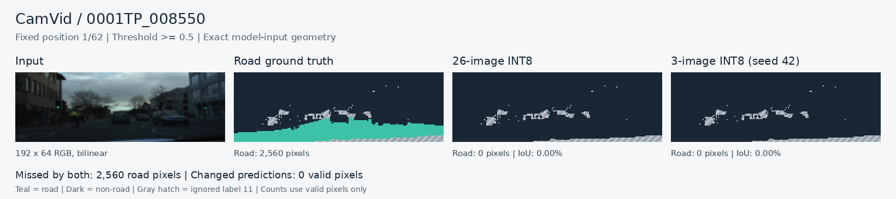
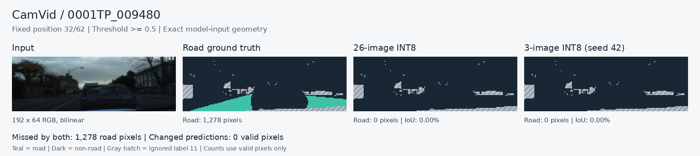
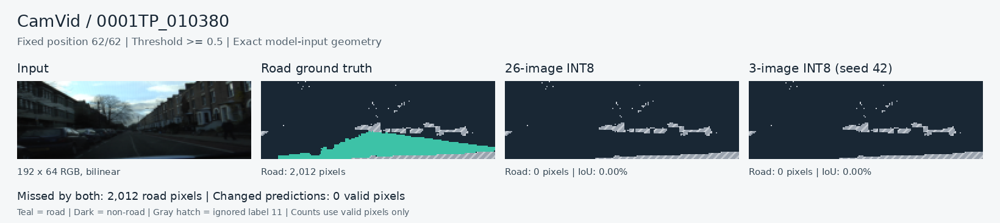

# CamVid 0001TP 검산과 장면 비교

**3장과 26장의 점수가 비슷한데, 두 모델 모두 도로를 놓친 건 아닐까?**

`0001TP`의 62프레임을 원시 CSV에서 다시 집계했다. 프레임별 점수를 평균하지 않고 각 모델의 TP·FP·FN을 모두 더한 뒤 IoU와 재현율을 계산했다. 첫·중간·마지막 장면은 숫자 순서로 **1번째·32번째·62번째**를 고정했으며, 그 세 장면은 동일한 모델 파일로 새로 추론했다.

## 62프레임 검산

| 항목 | 26장 기준 | 3장 · 시드 42 |
|---|---:|---:|
| TP · 맞힌 도로 픽셀 | 3,952 | 3,954 |
| FP · 도로로 잘못 분류한 픽셀 | 525 | 537 |
| FN · 놓친 도로 픽셀 | 117,494 | 117,492 |
| TN · 맞힌 비도로 픽셀 | 587,417 | 587,405 |
| 정답 도로 픽셀 · TP + FN | 121,446 | 121,446 |
| 평가한 전체 픽셀 | 709,388 | 709,388 |
| 도로 IoU | **3.240114%** | **3.241435%** |
| 도로 재현율 | **3.254121%** | **3.255768%** |
| 정답 도로 중 놓친 비율 | **96.745879%** | **96.744232%** |
| 유효 영역의 도로 예측이 0인 프레임 | 44 / 62 | 45 / 62 |

26장 기준의 계산은 다음과 같다.

```text
IoU    = 3,952 / (3,952 + 525 + 117,494) = 3.2401144534%
재현율 = 3,952 / (3,952 + 117,494)       = 3.2541211732%
```

반올림하면 기존 보고서의 **IoU 3.24%, 재현율 3.25%**와 일치한다. 3장·시드 42의 IoU 차이는 **+0.001321%p**, 재현율 차이는 **+0.001647%p**다. 두 조건의 프레임 ID와 프레임별 정답 도로·평가 영역 크기도 모두 일치했다. TP가 합계에서 2픽셀 늘었다는 사실만으로 전체 62프레임의 예측 차이가 2픽셀뿐이라고 해석할 수는 없다.

[원시 CSV](../scenes.csv) · [검산·재추론 결과 JSON](summary.json) · [검산 코드](../../../scripts/verify_camvid_sequence.py)

## 미리 고정한 세 장면

각 그림은 왼쪽부터 **실제 모델 입력 → 도로 정답 → 26장 예측 → 3장·시드 42 예측**이다. 원본 480×360을 기존 전처리대로 192×64로 줄인 뒤, 그림에서는 픽셀 보간 없이 2배 확대했다. 청록색은 도로, 남색은 비도로, 회색 사선은 평가에서 제외한 라벨 11이다. 예측 마스크의 빈 도로 영역은 실제 재추론 결과이며, 렌더링 누락이 아니다. 평가 제외 영역을 포함한 전체 예측·확률·입력·정답·유효 영역 배열은 [masks.npz](masks.npz)에 보존했다.

### 첫 장면 · 0001TP_008550 · 1/62



화면 아래와 중앙으로 이어지는 정답 도로 **2,560픽셀을 두 모델 모두 놓쳤다.** 유효 영역의 도로 예측은 두 모델 모두 0픽셀이고, 서로 다르게 판단한 픽셀도 0개다.

### 중간 장면 · 0001TP_009480 · 32/62



앞차가 화면 중앙을 차지한다. 정답에서 도로로 표시된 앞차 양옆의 **1,278픽셀을 두 모델 모두 놓쳤다.** 차량 자체는 도로 정답에 포함되지 않는다. 두 모델의 유효 영역 예측 차이는 0픽셀이다.

### 마지막 장면 · 0001TP_010380 · 62/62



정답 도로가 화면 아래에서 중앙으로 이어지지만, 두 모델 모두 **2,012픽셀 전부를 놓쳤다.** 유효 영역의 도로 예측과 두 모델의 예측 차이는 각각 0픽셀이다.

세 장면 합계에서 두 모델이 공통으로 놓친 도로는 **5,850픽셀**이다. 이 세 장면에서는 평가 제외 영역에도 도로 예측이 없었다. 세 장면은 시간 위치를 고정해 고른 표본이며, 전체 주행의 모든 실패 유형을 대표한다고 보지는 않는다. 위 62프레임의 집계는 기존 CSV 검산이고, 이번에 모델 추론을 다시 실행한 범위는 이 세 프레임·두 모델이다.

## 관찰과 원인 가설

| 구분 | 확인 내용 |
|---|---|
| 확인한 관찰 | 두 조건의 62프레임 재현율은 약 3.25%다. 고정한 세 장면에서 실제 모델 출력은 모두 도로 0픽셀이며, 도로 경계뿐 아니라 정답 도로 영역 전체를 놓쳤다. |
| 확인한 보정 장수의 차이 | 전체 집계의 TP는 3장 모델이 2픽셀 많고 FP는 12픽셀 많다. 세 장면에서는 보정 장수에 따른 예측 차이가 없다. |
| 아직 검증하지 않은 가설 | 도로의 밝기 분포, 촬영 구도, 480×360에서 192×64로 바뀌는 화면비가 공통 실패에 영향을 주었을 수 있다. 이번 관찰만으로 어느 조건이 원인인지 특정할 수 없다. |
| 원인을 가르기 위한 비교 | 가중치·평가 프레임·임계값을 고정하고 밝기 처리 또는 화면비 처리 중 한 조건씩 바꿔 비교해야 한다. CamVid에서의 변화와 함께 기존 KITTI 평가의 손실도 확인해야 한다. |

## 결론

`0001TP` 62프레임의 원시 통계를 합산하면 26장 기준 모델의 도로 IoU는 3.240114%, 재현율은 3.254121%이고, 3장·시드 42 모델은 각각 3.241435%, 3.255768%다. 두 모델은 실제 도로의 약 96.75%를 놓쳤으며, 미리 정한 첫·중간·마지막 프레임을 다시 추론했을 때도 두 모델 모두 정답 도로 5,850픽셀 전부를 놓쳤다. 따라서 이 주행에서 보정 장수를 줄인 상대 손실은 작지만, 점수가 비슷하다는 이유로 새 주행에서의 도로 인식이 충분하다고 판단할 수 없다. 세 장면에서는 보정 장수에 따른 예측 차이가 없었고, 조명·촬영 구도·화면비 변환이 실패 원인인지는 별도의 통제 실험이 필요하다.

## 실행과 검증 범위

CSV 검산은 Python 표준 라이브러리만 사용하며 기존 점수 집계 함수를 호출하지 않는다.

```bash
python scripts/verify_camvid_sequence.py --output work/camvid-count-recheck
```

세 장면의 실제 추론과 그림까지 다시 만들려면 저장소의 고정 의존성을 설치한다. 필요한 CamVid 원본 이미지와 라벨 여섯 개는 고정 리비전에서 내려받아 해시를 확인한 뒤 `work/camvid-review/source`에 저장한다. 이미 있으면 같은 해시를 확인하고 재사용한다. 출력 디렉터리는 새 경로여야 한다.

```bash
python -m pip install -r requirements.lock
python scripts/verify_camvid_sequence.py --render --output work/camvid-scene-recheck
```

- 26장 모델은 기존 `artifacts/int8.tflite`를 사용했다. SHA-256은 `432f3e474028eec892ecb25a359e7e20ba41b8b90264ffdb6a1defa589785cc5`다.
- 3장·시드 42 모델은 기존 `road.keras`와 KITTI 이미지 `um_000062`, `umm_000041`, `uu_000059` 순서로 다시 변환했다. KITTI 원본 ZIP·가중치·분할 파일을 기존 해시와 대조했으며, 생성된 모델은 [원래 기록](../../calibration/runs.csv)의 SHA-256 `72d2e83ea56b32c389d8b8b311fc007cedc3f389dbdefdd1e6f472eecf1eab53`과 일치했다. 재실행에 사용할 같은 파일은 [int8-3-seed42.tflite](../../calibration/int8-3-seed42.tflite)에 보존했다.
- 원본 이미지와 라벨 여섯 개 및 축소한 RGB 입력 세 개의 해시를 [기존 프레임 목록](../frames.csv)과 대조했다. 새로 실행한 두 모델·세 프레임의 TP·FP·FN·TN **24개 정수 값이 기존 CSV와 모두 일치**했다.
- 입력은 RGB·bilinear·0~1·192×64, 라벨은 최근접 변환·road ID 3·제외 ID 11, 출력 임계값은 0.5다. 기존 `RoadRuntime`의 CPU 1스레드 실행 경로를 사용했다. 모델 입력과 출력의 실제 양자화 설정 및 라이브러리 버전은 `summary.json`에 있다.
- 실행 시점 데이터 기준은 RoadLens 커밋 `7a4232af907a75115393c430a4bf8c3d5742a1dc`다. 원시 CSV의 SHA-256은 `e4e35e25f27d82d73cdf101e9e169a7cac3881cf591cb92631706e5a7fa44aed`다. 기존 CSV·모델 가중치·평가 프로토콜은 수정하지 않았다.

사진과 라벨 출처: [CamVid 원저자 자료](https://mi.eng.cam.ac.uk/research/projects/VideoRec/CamVid/) 및 [SegNet 저자 배포본](https://github.com/alexgkendall/SegNet-Tutorial/tree/bb68b64e72cb004b3ed927fee0f5624dd8097498/CamVid). 비교 그림의 입력은 해당 사진을 축소했으며, 마스크는 같은 라벨과 이번 재추론 출력에서 만들었다. KITTI 학습 자료와 모델의 이용 조건은 [NOTICE.md](../../../NOTICE.md)에 있다.
