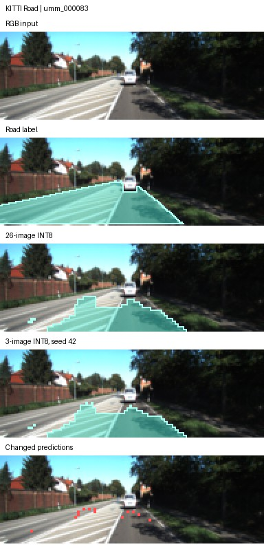

# 보정 이미지 선택이 도로 분할에 미치는 영향

지원자는 같은 가중치와 평가 62장을 고정하고 보정 이미지를 3·9·26장으로 바꿨다. 3장과 9장 모두 세 시드에서 전체 도로 IoU가 26장 기준보다 0.5%p 넘게 떨어지지 않았다. [사전에 정한 판정 기준](calibration_protocol.md) · [지원자 실험 7조건](../artifacts/calibration/runs.csv)

<h2 id="scene">같은 장면에서 26장과 3장의 예측 비교</h2>

`umm_000083` · 시드 42. 26장 보정의 IoU는 **50.72%**, 3장 보정은 **48.97%**였다. 유효 픽셀 12,282개 중 52개에서 예측이 달랐다. 아래 그림은 위에서부터 입력, 정답, 26장, 3장, 차이 순서다. 청록색은 도로이고 빨간색은 예측이 달라진 픽셀이다.



[원래 장면별 측정 434행](../artifacts/calibration/scenes.csv) · [KITTI 이미지 출처와 라이선스](../NOTICE.md)

## 반복 횟수를 늘리면 결과가 유지되는가?

Codex가 기존 시드 17·42·731에 0부터 16까지를 추가했다. 원래 보정 풀 26장, 가중치, 도로 유형별 한 장 우선 선택, 같은 시드에서의 3장 ⊂ 9장, 평가 장면 및 허용폭은 고정했다. 26장 기준은 전체 도로 IoU 77.5471%, 무표시 도로(UU) IoU 70.8907%다.

| 보정 장수 | 평가한 시드 | 전체 IoU 최솟값~최댓값 | UU 22장 IoU 최솟값~최댓값 | 전체 IoU 기준 통과 |
|---|---:|---:|---:|---:|
| 3장 · 지원자 실험 | 3 | 77.5628~77.5697% | 70.9381~71.0267% | 3/3 |
| 9장 · 지원자 실험 | 3 | 77.5675~77.5819% | 70.9074~70.9406% | 3/3 |
| 3장 · Codex 확장 | 20 | 77.4948~77.6179% | 70.8131~71.0267% | 20/20 |
| 9장 · Codex 확장 | 20 | 77.5412~77.6202% | 70.8789~70.9793% | 20/20 |

원래 세 시드에서는 9장 쪽의 전체 IoU 범위가 더 넓었다. 20개 시드에서는 3장 **0.1231%p**, 9장 **0.0790%p**로 순서가 바뀌었다. 3장 최저값도 전체 허용폭 안에 들었지만, 시드 7의 같은 장면에서는 3장 IoU가 **48.71%**까지 낮아졌다. 이 수치는 한 모델·한 분할에서 보정 이미지 선택을 바꾼 범위다. 1·2장은 시험하지 않았다. [보정 ID](../artifacts/calibration_extended/selected_ids.json) · [41개 변환 결과](../artifacts/calibration_extended/runs.csv) · [장면별 2,542행](../artifacts/calibration_extended/scenes.csv)

<h2 id="profile">CPU 실행 구간별 지연시간</h2>

Codex가 기존 FP32와 26장 보정 INT8 모델에서 **메모리의 PNG 바이트 → 이진 도로 마스크** 경로를 새로 측정했다. AMD EPYC 9V74, CPU/XNNPACK, 배치 1, 인터프리터 1스레드, 모델당 워밍업 20회 후 같은 62장 × 10회다. 매 반복에서 장면을 섞고 각 장면의 두 모델 순서도 섞었다. 단위는 ms다.

| 측정 구간 | FP32 p50 | FP32 p95 | INT8 p50 | INT8 p95 |
|---|---:|---:|---:|---:|
| PNG 디코딩·리사이즈·정규화 | 9.586 | 11.451 | 9.457 | 11.143 |
| TFLite invoke | 1.037 | 1.266 | 0.460 | 0.594 |
| CPU 어댑터의 나머지 처리 | 0.079 | 0.133 | 0.130 | 0.207 |
| 임계값 적용 | 0.004 | 0.005 | 0.003 | 0.005 |
| PNG 바이트부터 마스크까지 | **10.730** | **12.750** | **10.090** | **11.859** |

이 실행에서 INT8의 순수 추론 중앙값은 55.6% 줄었지만 전체 경로의 중앙값은 **6.0%** 줄었다. 가장 오래 걸린 구간은 PNG 입력 준비였다. 각 열의 분위수는 개별 호출에서 계산했다. 총시간은 한 호출의 시작과 끝에서 직접 측정했다. 카메라 캡처, 저장장치 읽기, 화면 표시는 측정 범위 밖이다. 기존 21초 영상의 **0.971→0.427ms**는 입력을 미리 준비한 별도 실행에서 측정한 순수 추론 중앙값이다. [호출별 원시 시간](../artifacts/pipeline/timings.csv) · [환경·분위수](../artifacts/pipeline/summary.json) · [측정 코드](../src/profile_pipeline.py)

**NPU 컴파일 결과**에서 Arm Vela 4.4.1은 Ethos-U55-128용 INT8 모델을 NPU 1구간, CPU 0연산에 배치했다. 500MHz 예제 설정에서 628,069사이클과 SRAM 276KiB를 추정했다. 실제 NPU 보드 지연시간·전력은 미측정이다. [컴파일 출력과 CPU fallback 분석](runtime.md)

## 재현

저장소 루트에서 의존성을 설치하고 기존 실험에 사용한 KITTI Road ZIP 경로를 지정한다. 새 실행은 비어 있는 출력 경로를 사용한다. 독립 검산기는 저장소에 공개된 모델 해시와 장면별 픽셀 집계를 다시 확인한다.

```bash
python -m src.calibration_experiment --extended --archive work/data_road.zip --out work/repeat-20
python -m scripts.verify_calibration --extended --archive work/data_road.zip
python -m src.profile_pipeline --archive work/data_road.zip --out work/repeat-profile
```

## 참고 사례에서 적용한 방법

| 참고 사례 | RoadLens에서 적용한 점 |
|---|---|
| [Self-Driving-ish](https://github.com/iwatake2222/self-driving-ish_computer_vision_system) · [KITTI 교육 프로젝트](https://github.com/pszczesnowicz/SDC-P12-Semantic-Segmentation) | 같은 입력의 예측과 실패 장면을 첫 화면에 나란히 제시했다. |
| [PTQ4ViT](https://github.com/hahnyuan/PTQ4ViT) · [PTQ 신뢰성 연구](https://openreview.net/pdf?id=iKBdmOVJ5T) | 보정 선택을 20회 반복하고 전체, 무표시 도로, 한 장면의 손실을 따로 확인했다. |
| [JetDriveRT](https://github.com/1569084106/JetDriveRT) · [F1Tenth](https://github.com/neelmulayPenn/F1Tenth-Vision-Pipeline) | 지연시간의 시작과 끝을 정의하고 전처리·호출·후처리·전체를 같은 프레임에서 측정했다. |
| [FuriosaAI 프로파일러](https://developer.furiosa.ai/docs/latest/en/software/profiler.html) · [Rockchip RKNN Model Zoo](https://github.com/airockchip/rknn_model_zoo) | 측정 장치와 컴파일 대상을 각 결과에 명시했다. |
