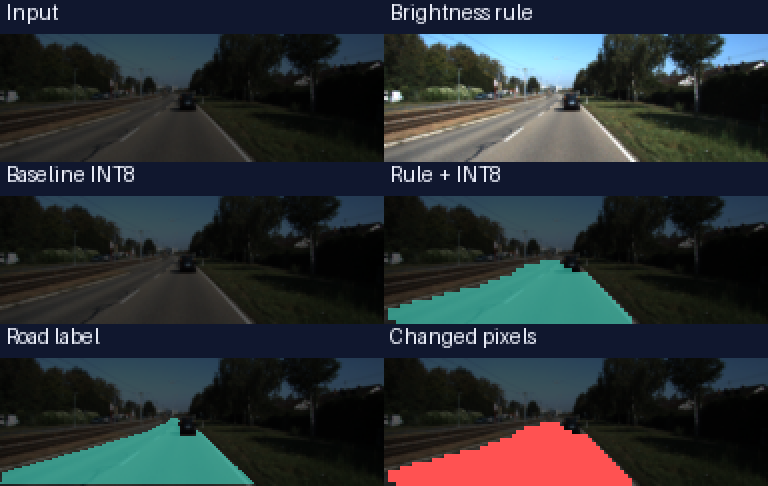
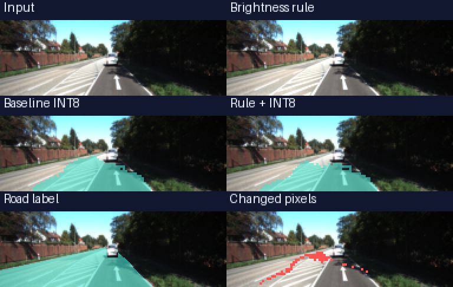

# 어두운 입력을 밝히면 도로 분할도 개선될까?

**기본 적용 보류.** 같은 INT8 모델에서 밝기 35% 조건의 전체 도로 IoU는 33.06%에서 77.31%로 올랐다. 그러나 원본 장면 `umm_000082`는 63.76%에서 56.08%로 떨어져 미리 정한 정상 장면 하락 한도 5%p를 넘었다. 기존 공개 추론기와 21초 영상은 기준 모델의 결과를 제공한다.

이 실험은 Codex가 수행한 후속 분석이다. 지원자가 직접 한 **보정 이미지 수 실험**은 양자화할 때 사용하는 대표 입력을 바꾼다. 이번 **입력 밝기 실험**은 이미 변환된 모델의 가중치와 정밀도를 그대로 두고 추론 직전의 입력을 바꾼다. [지원자 실험](calibration_review.md) · [평가 전 정한 규칙·판정 기준](exposure_protocol.md)

## 동일한 62장에서 비교한 결과

학습 이미지 201장의 장면 평균 휘도로부터 적용 경계 0.33946과 목표 0.36165를 얻었다. 어두운 장면에만 최대 3배의 선형 이득을 적용했다. 조건별로 유효 영역의 TP·FP·FN을 먼저 합산해 IoU를 구했다. 네 조건은 같은 62장의 변형이며 서로 독립인 248장이 아니다.

| 평가 조건 | 규칙 작동 | 기준 INT8 | 밝기 규칙 + INT8 | 변화 |
|---|---:|---:|---:|---:|
| 원본 | 11/62 | 77.55% | 77.45% | −0.09%p |
| RGB 밝기 35% | 62/62 | 33.06% | 77.31% | +44.25%p |
| 중앙 가림 | 29/62 | 74.73% | 74.42% | −0.31%p |
| 고정 감마 2.0 | 62/62 | 59.87% | 66.64% | +6.78%p |

변화량은 반올림 전 수치로 계산했다. 네 조건의 합산 기준은 모두 통과했고, 원본 한 장의 허용 하락폭에서 탈락했다. 감마 결과는 어둡게 만드는 방식에 따라 효과가 달라진다는 점을 보여준다. 실제 야간의 노이즈, 역광, 노출 제어, 모션 블러에 대한 결과와 전처리의 장치 지연시간은 미측정이다. 기존 실패를 보고 같은 평가 분할에서 진행한 탐색적 실험이다.

## 원래 실패 장면과 회귀 장면

각 그림의 첫 줄은 입력과 밝기 조정 후 입력, 둘째 줄은 기준 예측과 조정 후 예측, 셋째 줄은 정답과 예측 차이다. 청록은 도로, 빨간색은 유효 영역 안에서 두 예측이 달라진 픽셀이다.

**합성 저조도 · um_000028.** 기준 모델은 정답 도로 2,252픽셀 전부를 놓쳤다. 밝기 규칙 적용 후 2,190개를 맞추고 도로 밖 190개를 잘못 포함했다. IoU는 **0.00% → 89.68%**였다.



**원본 · umm_000082.** 이득이 약 1.07배였지만 도로 누락 픽셀이 **1,014 → 1,239개**로 늘었다. 전체 평균보다 이 장면의 **−7.68%p**가 기본 적용 여부를 결정했다.



[248행 원시 픽셀 집계](../artifacts/exposure/scenes.csv) · [모델·데이터 해시와 다섯 판정 결과](../artifacts/exposure/summary.json) · [평가 코드](../src/exposure_study.py) · [영상 출처와 라이선스](../NOTICE.md)

## 재현

저장소 루트에서 원래 실험에 사용한 KITTI ZIP을 지정한다. 스크립트는 ZIP 해시를 확인하고, 기존 세 조건의 기준 INT8 혼동행렬 186개를 공개 CSV와 대조한 뒤 결과를 새 디렉터리에 저장한다.

```bash
python -m src.exposure_study --archive work/data_road.zip --out work/repeat-exposure
```
